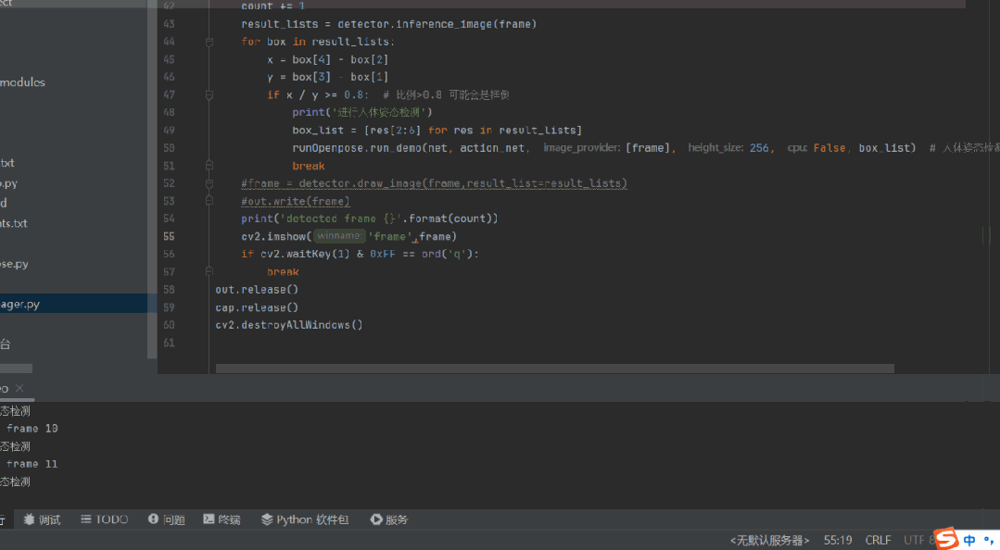

# Implementation of the Slipping Posture Recognition and Detection System Based on Yolov5 and OpenPose Human Bone Key Points

[Reference Source Code]

https://github.com/HRonaldo/Openpose_YOLO

This project has been comprehensively improved based on the framework above, with the following improvements:

(1) Package the YOLOv5 detection class to enhance ease of reading. The module design facilitates integration with other frameworks. I will switch to the YOLOv8 model for this project later. For the YOLOv8 porting project, please visit: https://blog.csdn.net/FL1623863129/article/details/142413295

(2) Adjust the folder structure, such as categorizing models into a single folder for easier viewing.

(3) The detection process is simplified, making the code for recognizing the fall posture of human body key points very simple. In fact, only over 40 lines of code are needed to implement the entire detection process.

[Effect Display]



[Special Attention]

Due to the use of three models in this project, the real-time performance is poor. It is recommended to use GPU inference to accelerate the inference speed. At the same time, try not to use cv2.imshow to display the window in real-time, but rather write the video results.

[Test Environment]

The code is provided with requirements.txt, but the environment is actually quite lenient, for example, my environment is

torch==1.9.0

opencv-python==4.8.0.76

[Implementation Code]

[Original Code]

detect.py

-
-
-
-
-
-
-
-
-
-
-
-
-
-
-
-
-
-
-
-
-
-
-
-
-
-
-
-
-
-
-
-
-
-
-
-
-
-
-
-
-
-
-
-
-
-
-
-
-
-
-
-
-
-
-
-
-
-
-
-
-
-
-
-
-
-
-
-
-
-
-
-
-
-
-
-
-
-
-
-
-
-
-
-
-
-
-
-
-
-
-
-
-
-
-
-
-
-
-
-
-
-
-
-
-
-
-
-
-
-
-
-
-
-
-
-
-
-
-
-
-
-
-
-
-
-
-
-
-
-
-
-
-
-
-
-
-
-
-
-
-
-
-
-
-
-
-
-
-
-
-
-
-
-
-
-
-
-
-
-
-
-
-
-
-
-
-
-
-
-
-
-
-
-
-
-
-
-
-
-
-
-
-
-
-
-
-
-
-
-
-
-
-
-
-
-
-
-
-
-
-
-
-
-
-
-
-
-
-
-
-
-
-
-

```
import argparseimport timefrom pathlib import Pathfrom torch import from_numpy, jit import cv2import torchimport torch.backends.cudnn as cudnnfrom numpy import randomimport osimport datetimefrom models.experimental import attempt_loadfrom utils.datasets import LoadStreams, LoadImagesfrom utils.general import check_img_size, non_max_suppression, apply_classifier, scale_coords, xyxy2xywh, \    strip_optimizer, set_logging, increment_pathfrom utils.plots import plot_one_boxfrom utils.torch_utils import select_device, load_classifier, time_synchronized import runOpenpose import YOLO  def detect(save_img=False):    global ip    source, weights, view_img, save_txt, imgsz = opt.source, opt.weights, opt.view_img, opt.save_txt, opt.img_size    webcam = source.isnumeric() or source.endswith('.txt') or source.lower().startswith(        ('rtsp://', 'rtmp://', 'http://'))     # Directories    save_dir = Path(increment_path(Path(opt.project) / opt.name, exist_ok=opt.exist_ok))  # increment run    (save_dir / 'labels' if save_txt else save_dir).mkdir(parents=True, exist_ok=True)  # make dir     # Load the model for fall detection    print("Start loading the model for fall detection.")    net = jit.load(r'action_detect/checkPoint/openpose.jit')    action_net = jit.load(r'action_detect/checkPoint/action.jit')    print("Model for load fall detection has been loaded.")    # Initialize    set_logging()    # Device acquisition    device = select_device(opt.device)    # If the device isgpu，UseFloat16    half = device.type != 'cpu'  # half precision only supported on CUDA    # Load model    # LoadingFloat32Model, ensure that the input image resolution set by the user can be evenly divisible.32（If not, adjust to be divisible and remove.）    #model = attempt_load(weights, map_location=device)  # load FP32 model     model=YOLO.Predictor(weights,device,opt.classes,opt.conf_thres)    imgsz = check_img_size(imgsz, s=32)  # !!!check img_size    # SettingFloat16    if half:        model.model.half()  # to FP16     # Set Dataloader    # Set different data loading methods through different input sources.    vid_path, vid_writer = None, None    if webcam:        view_img = True        cudnn.benchmark = True  # set True to speed up constant image size inference        dataset = LoadStreams(source, img_size=imgsz)    else:        save_img = True        # If you want to display the detected video, add a line here. view_img = True        view_img = True        dataset = LoadImages(source, img_size=imgsz)     # Get names and colors    # Get the name of a category    names = model.module.names if hasattr(model, 'module') else model.model.names    # Set the color of the frame    colors = [[random.randint(0, 255) for _ in range(3)] for _ in names]     # Run inference    t0 = time.time()    # Perform a forward inference to test if the program is working normally.    img = torch.zeros((1, 3, imgsz, imgsz), device=device)  # init img    _ = model.model(img.half() if half else img) if device.type != 'cpu' else None  # run once    """        path Image/Video path        img Performresize+padSubsequent images        img0 OriginalsizeImage        cap When reading an imageNone，When reading a video, it is the source of the video.        """    for path, img, im0s, vid_cap in dataset:        img = torch.from_numpy(img).to(device)        # Images are also set to...Float16        img = img.half() if half else img.float()  # uint8 to fp16/32        img /= 255.0  # 0 - 255 to 0.0 - 1.0        # Nobatch_size If so, add an axis at the beginning.        if img.ndimension() == 3:            img = img.unsqueeze(0)         # Inference        t1 = time_synchronized()         pred=model.predict(source=img)        t2 = time_synchronized()         # Process detections        # Process each image individually.        for i, det in enumerate(pred):  # detections per image            # If the input source is...webcam Thenbatch_size Not1，ExtractdatasetOne of the images in            if webcam:  # batch_size >= 1                p, s, im0, frame = path[i], '%g: ' % i, im0s[i].copy(), dataset.count            else:                p, s, im0, frame = path, '', im0s, getattr(dataset, 'frame', 0)            # print(det)             boxList = []  # One framelist Provideopenpose Use            p = Path(p)  # to Path            # Set to save images/Video path            save_path = str(save_dir / p.name)  # img.jpg            # Set the thinnest save boxtxtFile path            txt_path = str(save_dir / 'labels' / p.stem) + ('' if dataset.mode == 'image' else f'_{frame}')  # img.txt            # Set print information(Image dimensions)            s += '%gx%g ' % img.shape[2:]  # print string            gn = torch.tensor(im0.shape)[[1, 0, 1, 0]]  # normalization gain whwh            if len(det):                # Rescale boxes from img_size to im0 size                # Adjust the coordinates of the prediction box: based onresize+padCoordinates of the image -->Based on the originalsizeCoordinates of the image                # The current coordinate format isxyxy                det[:, :4] = scale_coords(img.shape[2:], det[:, :4], im0.shape).round()                 # Print results                # Print the number of categories detected                for c in det[:, -1].unique():                    n = (det[:, -1] == c).sum()  # detections per class                    s += f'{n} {names[int(c)]}s, '  # add to string                 # Write results                # Save the prediction results                for *xyxy, conf, cls in reversed(det):                    if save_txt:  # Write to file                        # Output:xyxy（Top left+Bottom right corner) Formatting toxywh（Center point+In the format of wide and tall, and divide byw,hNormalize and convert to a list before saving.                        xywh = (xyxy2xywh(torch.tensor(xyxy).view(1, 4)) / gn).view(-1).tolist()  # normalized xywh                        line = (cls, *xywh, conf) if opt.save_conf else (cls, *xywh)  # label format                        with open(txt_path + '.txt', 'a') as f:                            f.write(('%g ' * len(line)).rstrip() % line + '\n')                    # Draw a frame on the original image.                    if save_img or view_img:  # Add bbox to image                        label = f'{names[int(cls)]} {conf:.2f}'                        plot_one_box(xyxy, im0, label=label, color=colors[int(cls)], line_thickness=3)                        boxList.append([int(xyxy[0]), int(xyxy[1]), int(xyxy[2]), int(xyxy[3])])                 runOpenpose.run_demo(net, action_net, [im0], 256, False, boxList)  # Human Pose Detection - Image andyolov5The frame for detecting the human body is also passed toopenpose            # Print time (inference + NMS)            # Print forward propagation+nmsTime            print(f'{s}Done. ({t2 - t1:.3f}s)')             if save_img:                if dataset.mode == 'image':                    imageName = str(time.strftime('%Y%m%d%H%M%S', time.localtime(time.time()))) + ".jpg"                     cv2.imwrite(save_path+imageName, im0)                else:  # 'video'                    if vid_path != save_path:  # new video                        vid_path = save_path                        if isinstance(vid_writer, cv2.VideoWriter):                            vid_writer.release()  # release previous video writer                        fourcc = 'mp4v'  # output video codec                        fps = vid_cap.get(cv2.CAP_PROP_FPS)                        w = int(vid_cap.get(cv2.CAP_PROP_FRAME_WIDTH))                        h = int(vid_cap.get(cv2.CAP_PROP_FRAME_HEIGHT))                        vid_writer = cv2.VideoWriter(save_path, cv2.VideoWriter_fourcc(*fourcc), fps, (w, h))                    vid_writer.write(im0)                print('Save the image')     # Total print time    print(f'Done. ({time.time() - t0:.3f}s)')    cv2.destroyAllWindows()   if __name__ == '__main__':    parser = argparse.ArgumentParser()    # Use the trained weights, available in the root directory.yolov5s.pt，Also availableruns/train/exp/weights/best.pt    parser.add_argument('--weights', type=str, default='models/hub/yolov8s.pt', help='model.pt path(s)')    # Detection data, can be an image/Video path, or'0'(Computer built-in camera),It can also bertspWaiting for video streams    parser.add_argument('--source', type=str, default='0',                        help='source')  # file/folder, 0 for webcam    # Network input image size    parser.add_argument('--img-size', type=int, default=640, help='inference size (pixels)')    # Confidence threshold, the probability of detecting an object belonging to a specific class (dog, cat, banana, car, etc.)    parser.add_argument('--conf-thres', type=float, default=0.5, help='object confidence threshold')    # DonmsOutput the English term only:iouThreshold    parser.add_argument('--iou-thres', type=float, default=0.45, help='IOU threshold for NMS')    # Detection equipment，cpu；0(Represents agpuEquipmentcuda:0)；0,1,2,3(MultiplegpuEquipment)。When the value is empty, the computer's built-in graphics card orCPU    parser.add_argument('--device', default='gpu', help='cuda device, i.e. 0 or 0,1,2,3 or cpu')    # Display the image after detection?/Video, by default.False    parser.add_argument('--view-img', action='store_true', help='display results')    # Whether to use the detected box coordinates.txtSaved in file format, by default.False    parser.add_argument('--save-txt', action='store_true', help='save results to *.txt')    # Whether to detectlabels-txtSaved in file format, by default.False    parser.add_argument('--save-conf', action='store_true', help='save confidences in --save-txt labels')    # Set to retain only certain categories, such as0Or0 2 3    parser.add_argument('--classes', nargs='+', default=[0,67], type=int,                        help='filter by class: --class 0, or --class 0 2 3')    # PerformnmsWhether to also remove the frames between different categories, by default.False    parser.add_argument('--agnostic-nms', action='store_true', help='class-agnostic NMS')    # When performing inference, perform operations such as multi-scale and flipping.(TTA)Inference    parser.add_argument('--augment', action='store_true', help='augmented inference')    # IfTrue，Then, for all models.strip_optimizerOperation, removeptOptimizer information in the file, default toFalse    parser.add_argument('--update', action='store_true', help='update all models')    # The path where the detection results are stored, defaults toruns/detect    parser.add_argument('--project', default='runs/detect', help='save results to project/name')    # The name of the folder where the detection results are located, default isexp    parser.add_argument('--name', default='exp', help='save results to project/name')    # If existingproject/nameExists, then do not increment.    parser.add_argument('--exist-ok', action='store_true', help='existing project/name ok, do not increment')    opt = parser.parse_args()    print(opt)    with torch.no_grad():        detect()
```

My code

main_video.py

-
-
-
-
-
-
-
-
-
-
-
-
-
-
-
-
-
-
-
-
-
-
-
-
-
-
-
-
-
-
-
-
-
-
-
-
-
-
-
-
-
-
-
-
-
-
-
-
-
-
-
-

```
from torch import from_numpy, jitfrom Yolov5Manager import *import runOpenposeimport cv2  device = torch.device("cuda:0" if torch.cuda.is_available() else "cpu")# Load the model for fall detectionprint("Start loading the model for fall detection")net = jit.load(r'weights/openpose.jit', map_location=device)action_net = jit.load(r'weights/action.jit', map_location=device)print("Loadingyolov5Model")detector = Yolov5Manager()print('All models have been loaded.!')video_file = "video/tt.mp4"save_file = 'result.mp4'cap = cv2.VideoCapture(video_file) # Get video frame rate FPSframe_fps = int(cap.get(cv2.CAP_PROP_FPS))# Get the width and height of a video frameframe_width = int(cap.get(cv2.CAP_PROP_FRAME_WIDTH))frame_height = int(cap.get(cv2.CAP_PROP_FRAME_HEIGHT))print("video fps={},width={},height={}".format(frame_fps, frame_width, frame_height))fourcc = cv2.VideoWriter_fourcc(*'mp4v')out = cv2.VideoWriter(save_file, fourcc, frame_fps, (frame_width, frame_height))count = 0 while True:    ret, frame = cap.read()    if not ret:        print('read over!')        break    count += 1    result_lists = detector.inference_image(frame)    for box in result_lists:        x = box[4] - box[2]        y = box[3] - box[1]        if x / y >= 0.8:  # Proportional>0.8 It might be a fall.            print('Perform human posture detection')            box_list = [res[2:6] for res in result_lists]            runOpenpose.run_demo(net, action_net, [frame], 256, False, box_list)  # Human Pose Detection - Image andyolov5The frame for detecting the human body is also passed toopenpose            break    #frame = detector.draw_image(frame,result_list=result_lists)    #out.write(frame)    print('detected frame {}'.format(count))    cv2.imshow('frame',frame)    if cv2.waitKey(1) & 0xFF == ord('q'):        breakout.release()cap.release()cv2.destroyAllWindows()
```

If you want to add people, please turn on the annotations.

Line 52: #frame = detector.draw_image(frame, result_list=result_lists)

If you save the video, please open the annotation.

Line 53: #out.write(frame)

[Extended Extension]

Run runOpenpose.py
By running open pose, you can obtain the keypoints of the human body, which will be used for subsequent .jit model training. The keypoints of the human body will be saved in data/test. In pose.py, the bottom of the draw method can control where to save the keypoints.

If you want to detect other poses: 1. Collect images, run the `runOpenpose.py` file to obtain the keypoints of the human body. 2. Classify the keypoints of the human body according to your own needs and place them in `data/train` and `data/test`. 3. Run `action_detect/train.py`


## Payment

Here is a pay link on Stripe ( https://buy.stripe.com/3cs8yP7sY87d0vu9AB ). Please contact me lonlonago@foxmail.com after funding $89, and I will send you a complete data files , thank you!


